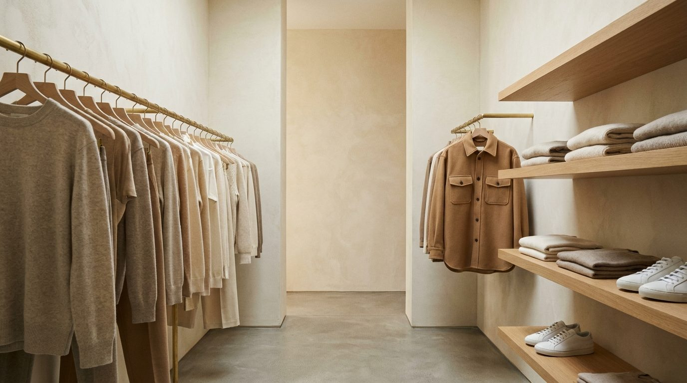
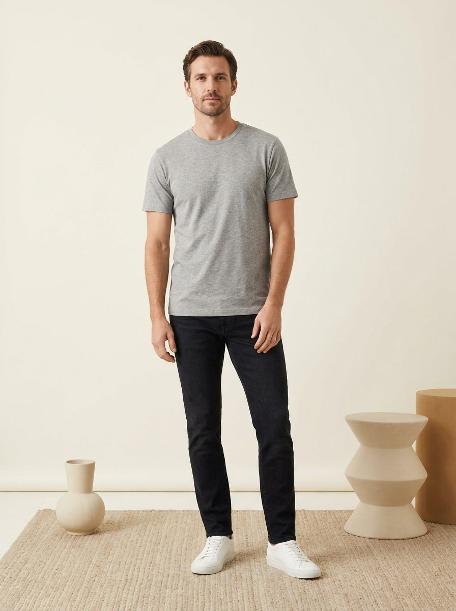
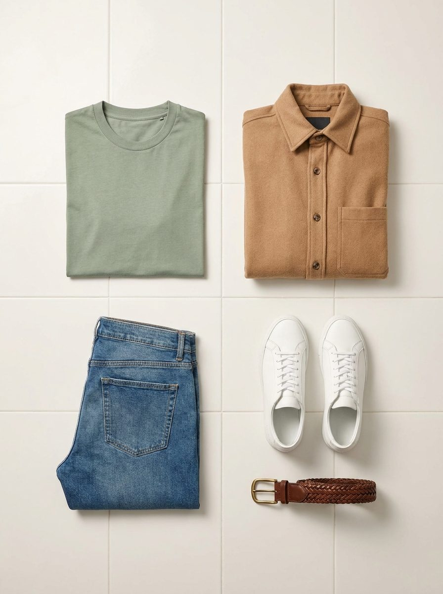
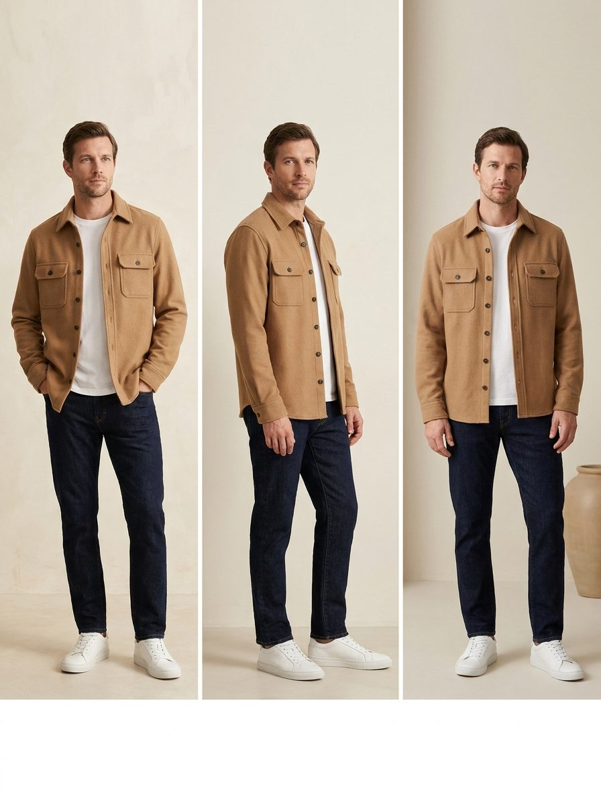

<div align="center">

# S T Y L E C H E C K<sub>.</sub>

**Your wardrobe, styled.** A personal AI stylist that catalogues every piece you own,<br/>knows your build, your age, and today's weather — and shows you wearing the outfit<br/>*before you get dressed.*

[**mystylecheck.vercel.app**](https://mystylecheck.vercel.app)




</div>

## How it works

<table>
<tr>
<td width="33%" align="center">
  <br/><br/>
  <b>01 · Build your mannequin</b><br/>
  <sub>Upload a selfie and a full-body shot. StyleCheck builds a photoreal, identity-locked render of <i>you</i> — face, build, height, honest silhouette. Tune it with body-calibration dials.</sub>
</td>
<td width="33%" align="center">
  <br/><br/>
  <b>02 · Catalogue your closet</b><br/>
  <sub>Photograph clothes worn, hung, or heaped. Every piece is detected (even multiple per photo), named, and re-shot as a clean retail-style product image — automatically.</sub>
</td>
<td width="33%" align="center">
  <br/><br/>
  <b>03 · Generate. Voilà.</b><br/>
  <sub>A minimal-fashion stylist composes outfits from your actual wardrobe — age-, weather-, and occasion-aware — and renders each on your mannequin, head to shoes, with the "why".</sub>
</td>
</tr>
</table>

## Highlights

- **A wardrobe you can walk into** — the home screen is an AI-composed walk-in-closet scene built from your real pieces, with clickable rails and shelves. Cached and refreshed nightly only when your wardrobe changes.
- **Identity engine** — renders are grounded in your real photos plus a stored "identity passport" (a verified physical description), edit-framed off one anchor mannequin so your face stays *your face* across every look.
- **Profiles & sharing** — multiple people per account (you, your kid). Share any profile by email as viewer or manager; permissions live in the database (RLS), not just the UI.
- **Fit intelligence** — occasion tags (work / casual / friends / date), stylist explanations, one-tap subtle variations ("same fit, different jeans"), rating filters, and per-fit re-renders.
- **Goofy mode** — every fit optionally gets an identity-locked comedy-pose take. Swipe between classic and goofy. Zero dignity, full likeness.
- **Never-delete media** — soft deletes only; every render is kept with its model tag for side-by-side model comparison (Gemini default, OpenAI slot wired).
- **Nightly automation** — 2am crons refresh scenes, backfill product shots, and run queued full-wardrobe restyles, self-chaining across serverless limits.

## Stack

| Layer | Choice |
|---|---|
| Framework | Next.js 16 (App Router, Turbopack) |
| Styling | Tailwind CSS 4, light editorial theme (Inter + Instrument Serif) |
| Auth / DB / Storage | Supabase (Google OAuth, Postgres with RLS, private storage bucket) |
| AI | Gemini via `@google/genai` (text + vision + image gen), with an OpenAI provider slot |
| Hosting | Vercel (project `stylecheck`) |

### ⚠️ Shared Supabase project

The Supabase free tier is at its 2-project limit, so StyleCheck lives **inside the
shared project `zwwkcwdqsplztlmyfpyf` ("kbro-db1")** — the same project that backs
snobaddy/opencourt/deadcode:

- All tables are prefixed `sc_` and RLS-scoped to the signed-in user.
- Storage uses a dedicated private bucket named `stylecheck` (paths are `{userId}/…`).
- Google OAuth was already configured on that project; StyleCheck's redirect URLs
  (`https://stylecheck.vercel.app/**`, `https://stylecheck-*.vercel.app/**`,
  `http://localhost:3000/**`) are already in the auth allow-list. **No manual auth
  setup is required.**
- Migration to a dedicated Supabase project is tracked in [BACKLOG.md](BACKLOG.md).

## Environment variables

Set in `.env.local` for dev and in Vercel project settings for deploys.

| Variable | Required | Purpose |
|---|---|---|
| `NEXT_PUBLIC_SUPABASE_URL` | ✅ | Supabase project URL (browser + server) |
| `NEXT_PUBLIC_SUPABASE_ANON_KEY` | ✅ | Supabase anon key (RLS enforced) |
| `SUPABASE_URL` | ✅ | Same URL, used by scripts |
| `SUPABASE_SERVICE_ROLE_KEY` | ✅ (scripts only) | Backfill script — bypasses RLS, never shipped to the browser |
| `GEMINI_API_KEY` | ✅ | Classification, styling, and image rendering (default provider) |
| `OPENAI_API_KEY` | optional | Enables the OpenAI provider toggle in Settings |

## Local dev

```bash
npm install
npm run dev   # http://localhost:3000
```

Sign in with Google — localhost is already on the auth allow-list.

## Deploy

Deployed on Vercel as project **stylecheck**. Every push to `main` deploys;
`vercel --prod` promotes to production. Environment variables above must exist in
Vercel (all environments; the service-role key is only needed if server code starts
using it).

## Data model

All tables `public.sc_*`, all RLS: `auth.uid()` owns its rows.

| Table | Holds |
|---|---|
| `sc_profiles` | height/weight, ZIP → lat/lon/place for weather, pointer to base body render |
| `sc_user_photos` | your uploaded photos (selfie / full-body auto-detected), soft-delete only |
| `sc_wardrobe_items` | one row per piece: category, colors, seasons, formality, style tags, original + catalogue image paths, model used |
| `sc_outfits` | composed fits: item ids, occasion, explanation, styling notes, variations (swap links), render pointer + status |
| `sc_renders` | **append-only render history** — every generated image (catalogue shot, base render, outfit render) with the model that made it |
| `sc_settings` | provider (gemini/openai), text/image model ids, feature toggles (accessories, shoes, belts, glasses=disabled, auto-render) |

**Images are never deleted.** Item/photo removal is a soft-delete flag; re-renders
append to `sc_renders` rather than overwrite, so you can switch models and compare
outputs later.

## Features

1. **Upload** — drag in a batch of photos. Client-side compression (≤~1280px JPEG)
   keeps uploads tiny. Each image is auto-classified: clothing/shoes/accessories become
   wardrobe items with full metadata; photos of *you* (including selfies) are detected
   and routed to your profile.
2. **Wardrobe** — a retail-style catalogue of everything you own. Each item can get a
   generated clean product shot (white background, catalogue lighting), created once
   and saved. Filter by category; disable pieces you don't want styled.
3. **Profile** — your photos, height, weight, and ZIP code. Weather for your location
   shows on the dashboard with a what-to-wear hint. Generate (and re-generate) a
   **base render**: a studio full-body image of you that anchors likeness for outfit
   renders.
4. **Fits** — the stylist composes as many outfits as your wardrobe supports, scored
   and classified by occasion (work / casual / friends / date / active / lounge) and
   season, weather-aware. Every fit has an explanation of *why it works for you*,
   styling notes, and **variation links** ("same tee, different pants") that render on
   click. Renders are full-frame, head to shoes, honest to your height/weight.
5. **Settings** — switch provider (Gemini default, OpenAI optional), pick models,
   toggle optional pieces (accessories/shoes/belts). Glasses support exists as a
   disabled toggle (v1 renders keep whatever eyewear your reference photos show).

## Backfilling from a local folder

A project-local Claude Code skill (`.claude/skills/backfill-wardrobe/`) processes a
directory of images on this machine straight into your profile — no browser uploads:

```bash
node scripts/backfill.mjs ~/Pictures/closet --email k4rthikr@gmail.com
```

Or just tell Claude: *"backfill my wardrobe from ~/Pictures/closet"*. Flags:
`--dry-run` (list only), `--limit N`. Requires `SUPABASE_URL`,
`SUPABASE_SERVICE_ROLE_KEY`, and `GEMINI_API_KEY` in `.env.local`, and that the
account has signed in to the app at least once.

## Roadmap

See [BACKLOG.md](BACKLOG.md).
